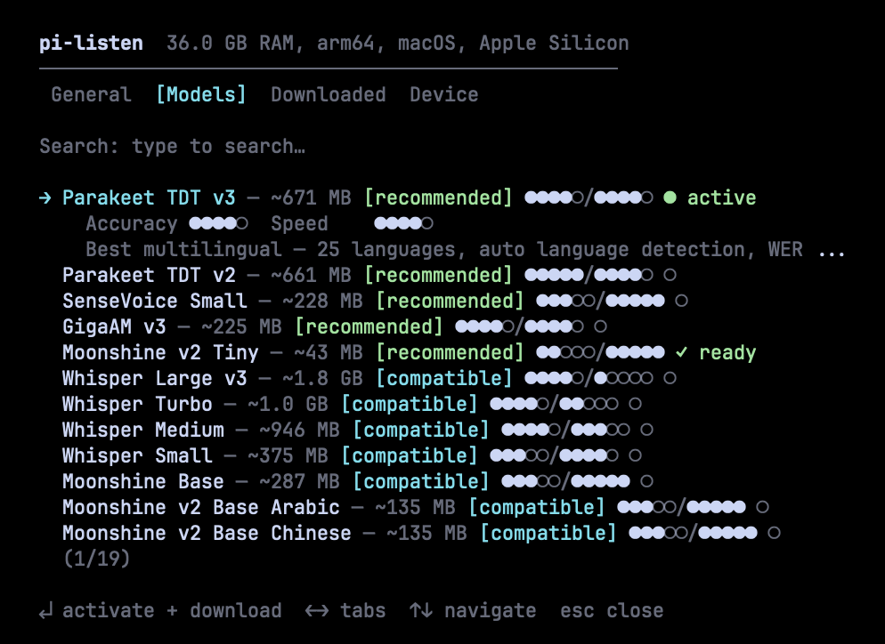
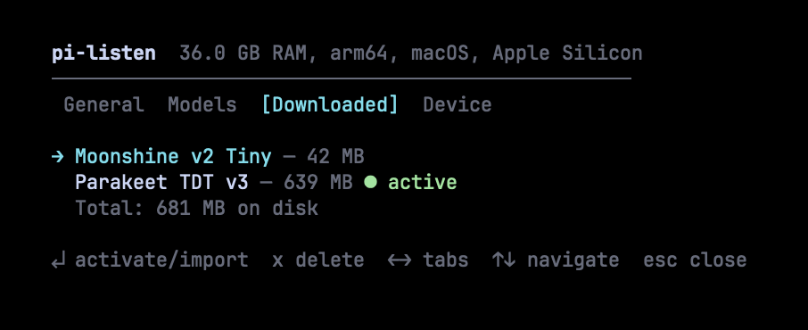
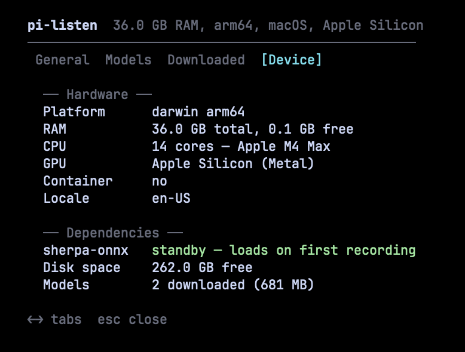

[English](../README.md) | [简体中文](README.zh-CN.md)

# pi-voicekit

> **基于 [`codexstar69/pi-listen`](https://github.com/codexstar69/pi-listen) 的社区延续项目**（上游，MIT — 自 2026 年 5 月 v7.2.2 起停止维护）。
> 与原作者无隶属关系。旧名称：`pi-listen`。
> **本项目移除了全部云端后端**（0.6.0）：听写、标点与朗读全部在本机完成，上游的双后端配置方式已不再适用 — 见[隐私](#隐私)。

<p align="center">
  
</p>

**为 [Pi](https://github.com/earendil-works/pi-coding-agent) 打造的语音输入与语音输出。**
按住说话式听写，可选 21 个离线模型，外加能把智能体回复朗读出来的语音合成。识别、标点和
合成全部在 Pi 进程内通过 [sherpa-onnx](https://github.com/k2-fsa/sherpa-onnx) 运行：
无需密钥、无需端点、无需账号，你的音频不会离开你的机器。

> **语言范围：中文与英文。** 识别与标点仅针对中文、英文以及中英混合听写做过验证。
> 模型恰好覆盖的其他语言都不在支持范围内，也未经验证 — 见[语言范围](#语言范围)。

[](https://www.npmjs.com/package/pi-voicekit)
[](https://github.com/CyFeng16/pi-voicekit/blob/main/LICENSE)
[](https://x.com/baanditeagle)

> **0.6.0 — 只剩一条路径：本地。** 两个云端后端已从代码中彻底移除：没有流式传输通道，
> 没有云端音色，也没有任何需要认证的东西。从 0.5.x 升级时，首次启动会清除
> `settings.json` 中已废弃的字段 — 见[隐私](#隐私)。更早的版本记录在[更新日志](../CHANGELOG.md)中。

---

## 看看它是如何工作的

<p align="center">
  <video src="../assets/demo/pi-voicekit-demo.mp4" controls width="100%"></video>
  <br>
  <em>演示视频</em>
</p>

---

## 安装配置（2 分钟）

### 1. 安装扩展

```bash
# 在普通终端中运行（不要在 Pi 内部运行）
pi install npm:pi-voicekit
```

### 2. 选择一个模型

在 Pi 内运行 `/voice-settings`，进入**模型**标签页，按 `↵` 选中你想要的模型。它只会
下载一次（最小的 43 MB，推荐的 Parakeet 为 671 MB），并成为当前激活模型。语言行随后
只会列出该模型支持的语言。

`/voice-setup` 打开的是同一个面板 — 它是别名，不是独立的向导。

这里的一切都不花钱、也不需要账号：模型都是公开下载，唯一占用的是磁盘空间。

### 3. 检查音频捕获

pi-voicekit 会自动检测你的音频工具。如果你已安装 sox 或 ffmpeg，就无需手动安装。

| 优先级 | 工具            | 支持平台              | 安装方式                                                     |
| ------ | --------------- | --------------------- | ------------------------------------------------------------ |
| 1      | **SoX** (`rec`) | macOS、Linux、Windows | `brew install sox` / `apt install sox` / `choco install sox` |
| 2      | **ffmpeg**      | macOS、Linux、Windows | `brew install ffmpeg` / `apt install ffmpeg`                 |
| 3      | **arecord**     | 仅 Linux              | 预装（ALSA）                                                 |

> 当设置了 `PULSE_SERVER`（SSH 音频隧道或远端 PulseAudio）时，优先级会变为
> **ffmpeg → sox → arecord** — 网络 Pulse 音源必须使用 ffmpeg。

### 4. 首次启动会看到什么

启动时 pi-voicekit 会报告它找到了什么、还缺什么：

- **本地模型。** 未选择模型时状态栏显示 `MIC SETUP`，语音保持关闭 — 完成过设置却没有模型的
  配置没有任何可用路径，因此扩展会把你送到 `/voice-setup`，而不是替你猜一个默认模型。
  选择模型后状态栏显示 `MIC LOCAL`。
- **音频工具。** `/voice test` 会报告检测到哪一个工具、麦克风是否真的录到了音频，以及
  sherpa-onnx 运行时是否加载成功。

两者齐备后，按住 `SPACE` 即可听写。

---

## 设置面板

所有配置集中在一处：`/voice-settings`。五个标签页覆盖你需要的全部内容。

### 通用 — 模型、语言、作用域、语音

设置本地模型、听写语言、作用域（全局或当前项目）、语音开关和自动发送。每一行都能用键盘
操作 — `↵` 修改，`← →` 切换标签页。

### 模型 — 浏览、搜索、安装



浏览来自 Parakeet、Whisper、Moonshine、SenseVoice、GigaAM、Paraformer 和 Qwen3 的 21 个模型。每个模型都会显示准确度与速度评分（●●●●○/●●●●○）、适配徽章和下载状态。支持模糊搜索，快速定位模型。按回车即可激活并下载。

> 截图取自 v7.0 构建：面板现在有五个标签页（新增了朗读页），模型目录也已增至 21 个。

### 已下载 — 管理已安装的模型



查看已安装的模型、总磁盘占用，以及当前激活的模型。按回车激活，按 `x` 删除。来自 [Handy](https://github.com/cjpais/handy) 的模型会被自动检测，并可导入而无需重新下载。

### 朗读 — TTS 模型与音色

二十个离线 TTS 模型（Kitten、Kokoro、Piper），最小约 13 MB，选中即下载；随后可选择音色、
设置语速，并开关智能体回复的自动朗读。面板中有一行 **Test**，会用同一条链路合成一句示例。

### 设备 — 硬件信息和依赖项



查看硬件信息（内存、CPU、GPU）、依赖状态（sherpa-onnx 运行时）、可用磁盘空间和已下载模型总量。模型推荐会基于这份硬件信息生成。

### 标点 — 离线、只插入标点

它不是标签页：标点是识别器与编辑器之间的自动步骤，默认开启。当转录文本含中文、且基本没有
标点时（低于每 20 个字符一个标点），进程内模型会插入句号、逗号和问号。它只能**插入**标点 —
传给它的文本其余字节全部保持原样 — 任何异常都会导致这段文本一个标点也不加。英文不支持
（该模型在英文上实测 F1 为 0.175）；已经足够密的文本（每 20 个字符及以上一个标点）不会被改动，
更稀疏的文本即使自带一两个标点也仍会被标点化。

该模型是一次性约 285 MB 的下载，在第一次有听写需要它时于后台拉取：这次听写在下拉开始时
不会得到标点。下载完成、通过摘要校验并且引擎构建成功之后（任一步都可能失败），后续符合条件
的听写才会被标点；在那之前它们都得不到标点，而 `/voice-punctuation status` 会报告状态。
开关是 `punctuationEnabled` 设置（`settings.json` 字段，默认开启 — 面板里没有对应的行），
`/voice-punctuation status` 会显示这一步是否运行、为什么没有运行，以及模型的状态。

---

## 使用方法

### 快捷键

| 操作             | 按键                    | 说明                                                     |
| ---------------- | ----------------------- | -------------------------------------------------------- |
| **录音到编辑器** | 按住 `SPACE`（≥0.7 秒） | 松开后完成转录。预热期间预录音频，确保不会错过第一个字。 |
| **切换录音**     | `Ctrl+Shift+V`          | 适用于所有终端 — 按一次开始，再按一次停止。              |
| **清空编辑器**   | `Escape` × 2            | 500 毫秒内双击清空所有文字。                             |

### 录音工作原理

1. **按住 SPACE** — 出现预热倒计时，音频采集立即开始（预录音）
2. **继续按住** — 音频流入内存缓冲区
3. **松开 SPACE** — 录音再持续 1.5 秒（尾部录音）以捕捉最后一个字，然后结束
4. 当前本地模型在进程内转录这段缓冲区（2–10 秒），文本经清理与标点处理后写入编辑器

### 命令

| 命令                     | 说明                                          |
| ------------------------ | --------------------------------------------- |
| `/voice-settings`        | 设置面板 — 模型、语言、作用域、设备           |
| `/voice-models`          | 设置面板（模型标签页）                        |
| `/voice-setup`           | 设置面板 — `/voice-settings` 的别名           |
| `/voice-language`        | 打开设置面板以切换听写语言                    |
| `/voice-speak <text>`    | 朗读给定文本（TTS）                           |
| `/voice-speak-test`      | 朗读一句示例文本                              |
| `/voice-speak-toggle`    | 启用 / 禁用 TTS                               |
| `/voice-speak-stop`      | 停止正在播放的 TTS                            |
| `/voice-autosubmit`      | 开关：转录文本自动发送给智能体（`on`/`off`）  |
| `/voice-punctuation`     | 离线标点：状态、模型状态、最近一次决策        |
| `/voice-hold-delay`      | 设置长按触发延迟（200-3000 毫秒，默认 700）   |
| `/voice-speak-models`    | 浏览 / 安装 TTS 音色模型                      |
| `/voice-speak-info`      | 诊断 TTS 状态                                 |
| `/voice-help`            | 键盘与命令速查（也可按 `F1`）                 |
| `/voice test`            | 完整诊断 — 音频工具、麦克风、sherpa 运行时    |
| `/voice on` / `off`      | 启用或禁用语音                                |
| `/voice dictate`         | 连续听写（无需按住按键）                      |
| `/voice stop`            | 停止当前录音或听写                            |
| `/voice history`         | 最近的转录记录（即写入编辑器的文本）          |
| `/voice info`            | 设置面板                                      |
| `/voice`                 | 开关切换                                      |

### v7.1 键盘操作

在设置面板中：

| 按键   | 操作                     |
| ------ | ------------------------ |
| `← →`  | 切换标签页               |
| `↑ ↓`  | 移动光标（跳过分组标题） |
| `↵`    | 选择 / 激活              |
| `esc`  | 返回主界面 / 关闭面板    |
| `type` | 输入关键字以搜索         |
| `bksp` | 删除搜索的最后一个字符   |

当安装进度挂件或播放指示器挂载时（前方没有浮层）：

| 按键  | 操作                                                    |
| ----- | ------------------------------------------------------- |
| `esc` | 取消正在进行的安装（从最近一个开始），然后停止播放      |
| `F1`  | 打开帮助浮层（始终可用）                                |

---

## 语言范围

**正式支持并验证：中文、英文，以及中英混合听写。**本仓库中所有与识别、标点、质量相关的决策都只针对这两种语言。

其他语言**暂不支持**：覆盖它们的模型仍留在目录里（它们是通用模型），但这里对它们没有任何验证——没有准确度数字、没有标点行为、没有设备推荐。它们在路线图上，不在支持矩阵里。

语言行只会列出当前激活本地模型支持的语言 — 单语模型会自动设定语言，纯英文模型会隐藏其他
选项；如果你想要的语言没有出现，请先换一个模型。

| 领域 | 在范围内 | 范围外（未验证） |
| ---- | -------- | ---------------- |
| 识别 | 中文、英文、中英混合 | 目录中的其他所有语言（日语、韩语、俄语、阿拉伯语、乌克兰语、越南语、西班牙语……） |
| 标点 | 目前仅中文；英文评估中 | 其他语言 |

---

## 本地模型

21 个模型，覆盖 7 个家族。按质量排序 — 最好的在前。仅中文与英文经过验证；下表列出的其他语言都不在支持范围内 — 见[语言范围](#语言范围)。

### 推荐首选

| 模型                | 准确度 | 速度  | 大小   | 语言           | 说明                 |
| ------------------- | ------ | ----- | ------ | -------------- | -------------------- |
| **Parakeet TDT v3** | ●●●●○  | ●●●●○ | 671 MB | 25（自动检测） | 综合最佳。WER 6.3%。 |
| **Parakeet TDT v2** | ●●●●●  | ●●●●○ | 661 MB | 英语           | 英语最佳。WER 6.0%。 |
| **Whisper Turbo**   | ●●●●○  | ●●○○○ | 1.0 GB | 57             | 覆盖最广，未验证。   |

### 快速轻量

| 模型                  | 准确度 | 速度  | 大小   | 语言           | 说明                        |
| --------------------- | ------ | ----- | ------ | -------------- | --------------------------- |
| **Moonshine v2 Tiny** | ●●○○○  | ●●●●● | 43 MB  | 英语           | 34ms 延迟。适合树莓派。     |
| **Moonshine Base**    | ●●●○○  | ●●●●● | 287 MB | 英语           | 口音识别表现良好。          |
| **SenseVoice Small**  | ●●●○○  | ●●●●● | 228 MB | 中/英/日/韩/粤 | 中小型中文最佳选择。        |

### 专项模型

| 模型                 | 准确度 | 速度  | 大小   | 语言 | 说明                                 |
| -------------------- | ------ | ----- | ------ | ---- | ------------------------------------ |
| **GigaAM v3**        | ●●●●○  | ●●●●○ | 225 MB | 俄语 | 俄语识别 WER 比 Whisper 低 50%。     |
| **Whisper Medium**   | ●●●●○  | ●●●○○ | 946 MB | 57   | 准确度好，速度适中。                 |
| **Whisper Large v3** | ●●●●○  | ●○○○○ | 1.8 GB | 57   | Whisper 系列最高准确度。CPU 上较慢。 |

此外还有 8 个面向特定语言的 Moonshine v2 变体 — 日语两个，韩语、阿拉伯语、中文、乌克兰语、
越南语、西班牙语各一个 — 其中只有中文在支持范围内。

### 本地模型工作原理

```
按住 SPACE → 音频写入内存缓冲区
                ↓
松开 SPACE → 缓冲区送入 sherpa-onnx（进程内）
                ↓
         CPU 上运行 ONNX 推理（2–10 秒）
                ↓
         最终转录文本写入编辑器
```

听写是批处理而非流式：转录文本在你说完后几秒出现。模型首次使用时会自动下载 — 可续传、
完成后校验，并会去重（不会重复下载）。设置面板会实时显示下载进度、速度和预计剩余时间。

来自 [Handy](https://github.com/cjpais/handy) 的模型（`~/Library/Application Support/com.pais.handy/models/`）会被自动检测，并可通过符号链接导入（零磁盘重复占用）。

---

## 性能

在维护者机器上实测：本地 CPU、无网络，覆盖 70 条已公开的语句（28 条中文、28 条英文、
14 条中英混合）。RTF 是处理时间除以音频时长 — 越低越好，低于 1.0 即快于实时。

| 识别器               | 中文 RTF | 英文 RTF | 混合 RTF | 每秒字符数 |
| -------------------- | -------- | -------- | -------- | ---------- |
| **paraformer-zh**    | 0.014    | 0.013    | 0.016    | 247–983    |
| **sensevoice-small** | 0.028    | 0.029    | 0.040    | 134–451    |
| **whisper-turbo**    | 0.372    | 0.369    | 0.395    | 7–27       |

端到端地看，标点这一步在运行时几乎不增加开销：在 27–32 个字符的输入上，模型调用在一次性
544 ms 加载后实测 p50 2.9 ms / p95 3.1 ms，全部在 CPU 上完成（见 docs/BENCHMARKS.md）。
`whisper-turbo` 在这三者中慢一个数量级，且在这份语料上准确度最低 — 它只用于对比测量，
不推荐在纯 CPU 环境使用。

测量协议、全部结果表与诚实边界都记录在
[docs/BENCHMARKS.md](../docs/BENCHMARKS.md) 中 — 只放在 GitHub 上，因为 npm 只发布扩展和本 README。

---

## 功能特性

| 功能               | 说明                                                                     |
| ------------------ | ------------------------------------------------------------------------ |
| **仅本地**         | 只有一条路径：进程内识别与进程内合成。没有端点、没有密钥、没有账号 — 见[隐私](#隐私) |
| **21 个本地模型**  | Parakeet、Whisper、Moonshine、SenseVoice、GigaAM、Paraformer、Qwen3 — 带准确度/速度评分 |
| **离线朗读**       | 20 个本地 TTS 模型（Kitten、Kokoro、Piper），通过系统播放器朗读智能体回复 |
| **统一设置面板**   | 所有配置集中在一个覆盖面板中 — `/voice-settings`                         |
| **设备感知推荐**   | 根据你的硬件为模型评分。只有同类最优模型才会标记 [recommended]。         |
| **企业级下载流程** | 预检查（磁盘、网络、权限），实时进度显示速度/ETA，下载后校验             |
| **Handy 集成**     | 自动检测 Handy 应用的模型，通过符号链接导入                              |
| **音频回退链**     | 依次尝试 sox → ffmpeg → arecord；设置了 `PULSE_SERVER` 时 ffmpeg 优先    |
| **预录音**         | 预热期间即开始音频捕获 — 你永远不会错过第一个字                          |
| **尾部录音**       | 松开后继续录音 1.5 秒，确保最后一个字不被截断                            |
| **离线标点**       | 中文听写若没有标点，由进程内模型补上句号、逗号和问号 — 只插入标点、不改措辞、失败即放行，不支持英文。两个引擎常驻内存（各约 300 MB），模型只拉取一次 — 见[引擎常驻](../docs/BENCHMARKS.md#engine-residency) |
| **中文 + 英文**    | 正式支持并验证的范围，含中英混合。目录中的其他语言均未验证 — 见[语言范围](#语言范围)。 |
| **连续听写**       | `/voice dictate` 用于长文本输入，无需按住按键                            |
| **打字冷却**       | 打字后 400 毫秒内的空格按住会被忽略                                      |
| **声音反馈**       | macOS 系统声音用于开始、停止和错误事件提示                               |
| **跨平台**         | macOS、Windows、Linux — Kitty 协议 + 非 Kitty 回退方案                   |

---

## 架构

```
# core
extensions/voice.ts                         主扩展 — 状态机、录音、UI、命令面
extensions/voice/config.ts                  配置加载、保存、迁移
extensions/voice/onboarding.ts              模型与语言选择器、首次使用流程
extensions/voice/audio-tool.ts              采集工具检测（sox / ffmpeg / arecord）
extensions/voice/hold-to-talk.ts            长按检测，Kitty 与非 Kitty 终端
extensions/voice/release-controller.ts      录音生命周期、松手处理

# speech-to-text
extensions/voice/local.ts                   模型目录（21 个模型）、进程内转录
extensions/voice/sherpa-engine.ts           sherpa-onnx 绑定 — 识别器生命周期、推理
extensions/voice/sherpa-loader.ts           原生模块懒加载
extensions/voice/model-download.ts          下载管理 — 续传、进度、校验、Handy 导入
extensions/voice/device.ts                  设备画像 — 内存、GPU、CPU、容器检测
extensions/voice/transcript-cleanup.ts      语气词清理与口语数字还原
extensions/voice/transcript-join.ts         分段拼接 — 中日韩边界不加空格

# offline punctuation
extensions/voice/punctuation.ts             离线标点 — 只插入标点的拼接，失败即放行
extensions/voice/punctuation-model.ts       标点模型 — 目录、摘要校验、下载

# text-to-speech
extensions/voice/speak.ts                   朗读入口、自动朗读接线
extensions/voice/tts-engine.ts              sherpa-onnx TTS 合成
extensions/voice/tts-local-models.ts        本地 TTS 目录 — 20 个模型（Kitten、Kokoro、Piper）
extensions/voice/tts-playback.ts            播放、缓冲、播放器检测
extensions/voice/tts-text-filter.ts         代码块过滤、分句预处理
extensions/voice/tts-onboarding.ts          TTS 引导流程
extensions/voice/tts-onboarding-overlay.ts  TTS 引导浮层
extensions/voice/tts-install-progress.ts    模型安装进度挂件
extensions/voice/tts-playback-indicator.ts  朗读指示器挂件

# settings and UI
extensions/voice/settings-panel.ts          设置面板 — 浮层、5 个标签页
extensions/voice/ui-picker.ts               通用列表选择器
extensions/voice/ui-help-overlay.ts         键盘与命令速查
extensions/voice/ui-aura.ts                 视觉基元（Liquid Braille、Aurora）
extensions/voice/ui-widget-base.ts          挂件注册表与基类
extensions/voice/ui-render-ticker.ts        共享渲染定时器
extensions/voice/ui-icons.ts                字形与图标集
extensions/voice/ui-width.ts                中日韩宽字符感知的宽度工具
extensions/voice/ui-locale-labels.ts        本地语言名与音色标签

# types
extensions/voice/sherpa-onnx-node.d.ts      可选原生模块的类型声明
```

---

## 配置

设置在 Pi 的设置文件中，位于 `voice` 键下：

| 作用域 | 路径                          |
| ------ | ----------------------------- |
| 全局   | `~/.pi/agent/settings.json`   |
| 项目   | `<project>/.pi/settings.json` |

```json
{
	"voice": {
		"version": 5,
		"enabled": true,
		"language": "en",
		"localModel": "parakeet-v3",
		"scope": "global",
		"onboarding": { "completed": true, "schemaVersion": 5 }
	}
}
```

从 0.5.x 沿用下来的文件里可能仍带有已废弃的语音后端字段；首次启动会清除它们并告知你 —
见[隐私](#隐私)。

长按触发延迟默认 **700 毫秒**（`/voice-hold-delay` 接受 200–3000 毫秒）。

### 标点

标点自动运行且默认开启。一次听写结束后，文本先被清理（见下表三个开关），再在满足
「含中文且标点密度低于每 20 个字符一个」时于本地插入标点；这一步只插入标点，不改动其他内容。
模型在进程内运行，它产生的唯一网络流量是模型自身的一次性下载。当前版本不支持英文，
英文文本会被同一规则跳过。被规则拒绝的文本不会得到标点，任何一次失败也一样。

两个引擎在整个会话中常驻：识别器一如既往，标点引擎在会话开始时构建，因此没有听写需要等它
（实测调用 0.2 ms，引擎 100 ms 内可用，构建耗时 50–544 ms）。在从未拉取过模型的机器上，
首次会话会去拉取：磁盘 285 MB，参考机器上每个引擎约 300 MB 内存 — 标点 292 MB、
`paraformer-zh` 识别器 316 MB。数字见[引擎常驻](../docs/BENCHMARKS.md#engine-residency)。

| 设置                          | 作用域     | 默认值  | 说明                                                                                                                               |
| ----------------------------- | ---------- | ------- | ---------------------------------------------------------------------------------------------------------------------------------- |
| `punctuationEnabled`          | 全局与项目 | `true`  | 对符合条件的转录运行离线标点。                                                                                                     |
| `fillerRemovalEnabled`        | 全局与项目 | `true`  | 从完成的转录中移除语气词 `呃` 和 `嗯`。                                                                                            |
| `numeralNormalizationEnabled` | 全局与项目 | `true`  | 还原口语标识符中的数字（`k 八 s` → `k8s`，`bf 十六` → `bf16`）以及裸的多段版本号（`零点九九点一` → `0.99.1`）。                     |
| `punctuationNoticeShown`      | 仅全局     | `false` | 记录本机的一次性升级提示是否已展示。                                                                                               |

三个开关的解析方式相同。机器级的 `false` 是最终结果：任何项目配置都无法把它重新打开，即使在
全局值被设为 `false` 之前该项目保存过 `true`。在此之下，显式的项目值优先 — 保存过 `false` 的
仓库在全局值后来变为开启时仍保持关闭 — 然后是全局值，最后是默认值。项目块中缺省的值继承全局值，
而不是默认值。清理先于标点运行，且各有独立开关，因此关闭标点仍会得到清理后的文本。

首次以项目作用域保存时，会把配置解析出的值（包括继承来的值）写进仓库的 `.pi/settings.json`，
三个键在那里都会变成具体的布尔值。这固定了项目值，但不会让该仓库豁免之后出现的机器级 `false` —
后者仍然到处生效。

`/voice-punctuation status` 会打印标点开关状态、模型是否已下载并通过摘要校验，以及本会话最近
一次听写中这一步的决策。模型位于 `~/.pi/models/punct-ct-transformer-zh-en/`，像其他下载一样出现
在「已下载」标签页中，选中那一行不会让它成为识别器。每一步会为每次听写写入一条只含元数据的
`voice-punctuation` 条目 — 不含转录文本 — 所以决策可查；在 `PI_VOICE_DEBUG` 下它还会为每次听写
记录一行日志，包含字符数、前后的标点数、门限、未运行时的原因以及耗时。更早版本中已移除的
`postProcess*` 键在加载时会被忽略 — 从不迁移，并在保存设置文件时原样保留。

---

## 隐私

**没有任何音频被传输到本机之外。** 录音、识别、标点与语音合成都运行在 Pi 进程内 — sherpa-onnx
以原生方式加载并在内存缓冲区上工作。没有需要配置的端点，没有需要粘贴的密钥，也没有需要创建的账号。

### 这道闸门检查的是什么

`tests/no-cloud-egress.test.ts` 是这条声明中可强制执行的那一半。它会解析 `extensions/` 下的每个
模块，并在以下情况失败：某个模块导入了已移除的 WebSocket 通道、出现了已退役的厂商标识符或主机名，
或者在两个模型下载模块（`model-download.ts`、`tts-local-models.ts`）之外调用了 `fetch`。

它比「本软件永远不会打开套接字」要窄得多，这一点值得直接说明：这道闸门锁定的是本仓库删掉的那个
通道与那个厂商，并阻止普通代码长出新的调用点。将来的模块仍然可能自己实现一个网络客户端 —
这正是为什么它是一份你可以阅读的测试，而不是散文里的一句承诺。

### 唯一的外发步骤

模型文件在首次使用时从 HuggingFace 或 GitHub Releases 下载一次：你选中的语音识别模型、你选中的
TTS 模型，以及需要它的机器上那份约 285 MB 的标点模型。下载可续传并在完成时校验：语音识别模型
的文件必须齐全且大小符合预期，标点模型则逐文件对照本仓库记录的 SHA-256 摘要。模型落到磁盘之后，
听写与朗读在断网状态下也可用。

### 留在本机的东西

- 一次听写保存在内存缓冲区中，转录写入编辑器后即丢弃；不会保存录音。（`/voice test` 确实会往临时
  目录写一个一秒的采样来证明麦克风可用 — 读到大小后立即删除。）
- 朗读会把合成音频写入权限为 `0600` 的临时 WAV，交给本机播放器（macOS 的 `afplay`、Linux 的
  `paplay`/`aplay`、Windows 的 PowerShell `SoundPlayer`），然后删除它。这正是本条声明写成「没有被
  传输到本机之外」而不是「从未离开进程」的原因：确实有一个本机子进程收到了这段音频，而它就在同一
  台机器上。
- `/voice history` 仅在内存中保留本会话的转录。
- `PI_VOICE_DEBUG=1` 会把诊断信息（包含最多 100 个字符的转录预览）追加到
  `$TMPDIR/pi-voice-debug.log`。除非你设置该变量，否则它是关闭的。
- 没有遥测、没有分析、没有崩溃上报：任何数据都不会被发送出去。

### 从 0.5.x 升级

0.6.0 移除了云端后端，因此首次启动会清除 `settings.json` 中保存的 `deepgramApiKey` 与
`localEndpoint`，并告知你做过这件事。文件其余部分保持原样、逐字节不变，包括
`JSON.parse`/`JSON.stringify` 无法保留的格式。从 shell 配置或 `~/.env.secrets` 导出的 API 密钥
不再被读取；扩展不会修改这些文件，请自行删除那一行。

漏洞报告请参阅 [SECURITY.md](../SECURITY.md)。

---

## 故障排除

在 Pi 内运行 `/voice test` 可获得完整诊断。

| 问题                                             | 解决方案                                                                                                        |
| ------------------------------------------------ | --------------------------------------------------------------------------------------------------------------- |
| 没有麦克风？提示 "No audio capture tool found"   | `brew install sox` 或 `brew install ffmpeg`                                                                     |
| 远程麦克风录不到声音                             | 音频经 PulseAudio/SSH 传输 — 请在 Pi 一侧安装 ffmpeg（设置了 `PULSE_SERVER` 时采集优先用 ffmpeg）                |
| 空格键不能激活语音                               | 运行 `/voice-settings` — 语音可能已禁用，或尚未选择模型                                                         |
| 完全不转录                                       | `/voice-settings` → 设备标签页查看 sherpa-onnx 状态；`/voice test` 会指出失败原因                                |
| 下载失败                                         | 部分下载会在重试时自动续传。在设备标签页中检查磁盘空间。                                                        |
| 不受支持的平台（32 位 ARM、Windows ARM64、musl） | 原生运行时不提供该平台的构建，错误信息会指明限制。请改用 glibc 的 x64/arm64 系统或容器，或 Windows x64 |
| macOS 上出现 `dyld: Library not loaded: libsimdjson` | Homebrew Node ABI 不匹配 — 运行 `brew reinstall node`，或改用版本管理的 Node（`mise`、`fnm`、`nvm`）         |

更多内容见 [docs/troubleshooting.md](../docs/troubleshooting.md)。

---

## 许可证

[MIT](../LICENSE) — 原作者 [@baanditeagle](https://x.com/baanditeagle)，现由 [CyFeng16](https://github.com/CyFeng16) 维护

---

## 链接

- **npm:** [npmjs.com/package/pi-voicekit](https://www.npmjs.com/package/pi-voicekit)
- **GitHub:** [github.com/CyFeng16/pi-voicekit](https://github.com/CyFeng16/pi-voicekit)
- **Pi CLI:** [github.com/earendil-works/pi-coding-agent](https://github.com/earendil-works/pi-coding-agent)
